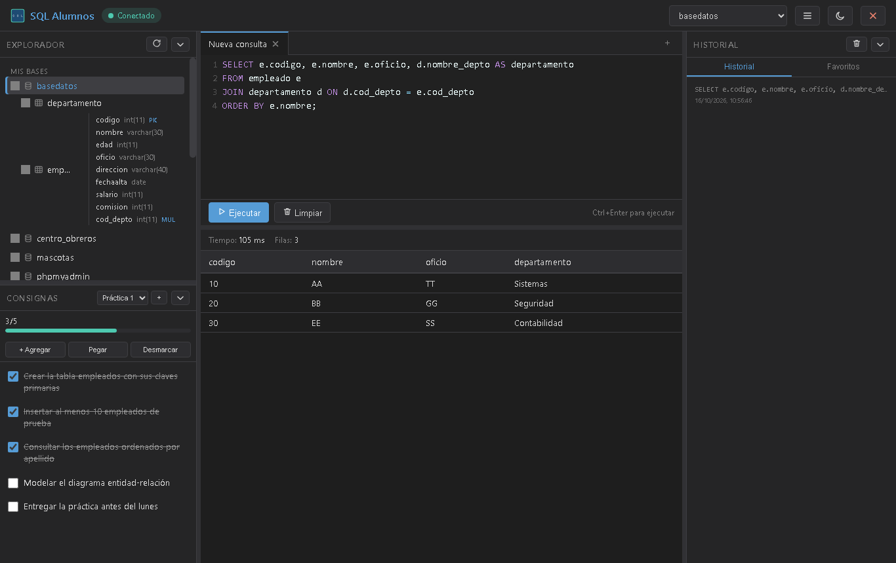
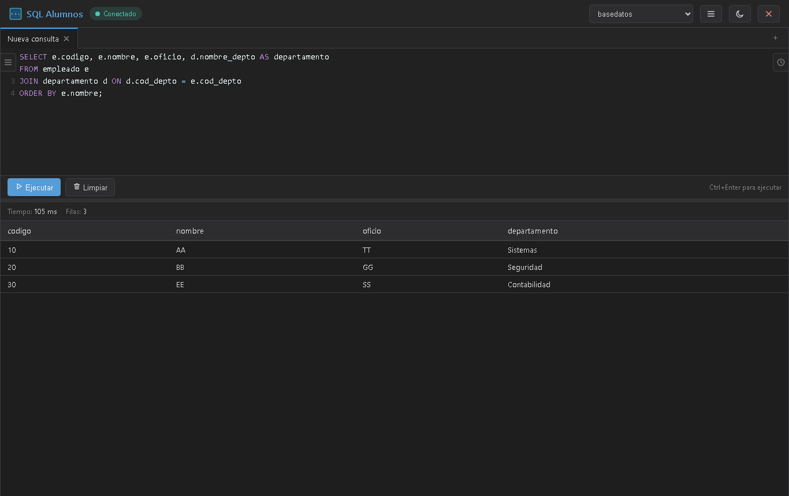

<div align="center">



# SQL Alumnos

**Un cliente SQL portable para practicar bases de datos, pensado para estudiantes.**

Cliente tipo HeidiSQL que corre en un `.exe` de Windows: editor con resaltado de sintaxis,
explorador de bases y tablas, historial de consultas y un panel de consignas con checklist
para llevar el progreso de las prácticas.

Sin instalar Java, sin internet y sin permisos de administrador: la carpeta se copia a un
pendrive y funciona en cualquier PC con Windows.

</div>

---

## Qué hace

- **Editor SQL con resaltado de sintaxis** (CodeMirror 5 en modo MySQL), autocompletado de
  tablas, varias pestañas de consulta y ejecución con `Ctrl+Enter` o `F9`.
- **Ejecuta varias sentencias** separadas por `;` respetando cadenas, comentarios y
  `DELIMITER`, y muestra un resultado por sentencia.
- **Explorador de bases, tablas y columnas** con carga perezosa. Un clic deja esa base como
  base de trabajo (no hace falta escribir `USE`) y un doble clic genera el `SELECT`.
- **Grilla de resultados** con tiempo de ejecución, filas devueltas, exportación a CSV y
  aviso cuando se truncan los resultados.
- **Consignas con checklist**: múltiples conjuntos, progreso, importar/exportar y pegar un
  bloque de texto.
- **Historial y favoritos** de consultas.
- **Paneles plegables y redimensionables** (F7, F8, F10) para agrandar la zona de consulta
  o la de resultados según lo que necesites ver.
- **Detecta si MySQL está apagado** y se reconecta solo cuando vuelve, sin mostrar errores técnicos.



## Por qué es portable

`build.bat` compila el proyecto y lo empaqueta con `jpackage --type app-image`, generando:

```
dist\SQLAlumnos\
├── SQLAlumnos.exe   lanzador sin ventana de consola
├── runtime\         runtime de Java incluido
├── app\             el jar y sus dependencias
├── data\            consignas, historial y preferencias (archivos JSON)
└── logs\            registro del programa
```

El lanzador es de tipo **GUI** (sin consola): toda la salida va a `logs\app.log` con rotación
por tamaño. Si el servidor no puede arrancar, se muestra un diálogo con el motivo en lugar de
fallar en silencio.

## Empaquetado y distribución

El ejecutable **no** va en el repositorio (son ~139 MB por el runtime de Java). Para
distribuirlo:

```bat
build.bat
```

Después, comprimí la carpeta `dist\SQLAlumnos\` y compartila como archivo o publicala como
*release*: quien la descomprima solo necesita tener MySQL activo.

## Requisitos

- Windows
- Java 17 o superior **solo para compilar** (el ejecutable ya lo incluye)
- MySQL o MariaDB (por ejemplo, el de XAMPP) activo en `localhost:3306`

## Compilar y ejecutar en desarrollo

```bat
build.bat                            :: compila y genera dist\SQLAlumnos\SQLAlumnos.exe
java -jar target\sql-alumnos-1.0.0.jar   ;; ejecutar sin empaquetar
```

La conexión se configura en `config.properties` (copiá `config.example.properties`).
Con MySQL apagado, `localhost:3306` y usuario `root` funciona sin tocar nada.

Para regenerar el ícono y el logo (opcional, solo si cambia el dibujo):

```bash
node build/generar-icono.cjs
```

## Tecnologías

| Capa | Tecnología |
|------|------------|
| Backend | Java 17, Javalin 6, JDBC con el driver de MariaDB, Gson |
| Frontend | HTML, CSS y JavaScript plano, CodeMirror 5 incluido localmente |
| Empaquetado | `jpackage` (app-image) con el runtime de Java embebido |
| Build | Maven (con Maven Wrapper incluido) |

Sin CDN y sin frameworks de frontend: todo el JavaScript y las hojas de estilo se sirven desde
la propia aplicación, así que el programa funciona sin conexión a internet.

## Estructura del proyecto

```
src/main/java/com/sqlplayground/
├── Main.java              Servidor, endpoints API y arranque
├── DatabaseService.java   Conexión a MySQL y base de datos activa
├── QueryService.java      Ejecución de sentencias y consulta de metadatos
├── SqlParser.java         División de sentencias SQL
├── StorageService.java    Persistencia en archivos JSON
├── ConfigService.java     Lectura de config.properties
├── ConsignasService.java  Conjuntos y consignas
├── HistorialService.java  Historial y favoritos
├── PestanasService.java   Pestañas y preferencias de la interfaz
└── RutasApp.java          Resuelve la carpeta del programa

src/main/resources/public/
├── index.html             Estructura de la interfaz
├── css/app.css            Estilos e íconos SVG
├── js/app.js              Lógica del frontend
└── lib/codemirror/        Editor (incluido, sin CDN)

build/generar-icono.cjs    Genera el ícono del ejecutable, el favicon y el logo
build.bat                  Compila y empaqueta
```

## Verificación

La interfaz se probó con una suite automatizada sobre Edge headless (Chrome DevTools Protocol):
**55 checks** que cubren el layout en distintas resoluciones y zooms, la ejecución de
sentencias, el explorador, el modal propio de diálogos, el plegado de paneles, la barra
divisoria y la ausencia de diálogos nativos del navegador. El mismo suite corrió contra el
`.exe` empaquetado.

## Notas

- Los datos del usuario (consignas, historial y preferencias) se guardan en archivos JSON
  dentro de `data/`, junto al ejecutable, para que se conserven al cambiar de PC o de puerto.
- Las bases del sistema (`information_schema`, `mysql`, `performance_schema`, `sys`) se
  muestran atenuadas y agrupadas aparte.
- Si el puerto 8080 está ocupado, el programa prueba con 8081, 8082, etc.

---

<sub>Hecho con Java, un poco de CSS y mucha paciencia con los desplegables.</sub>